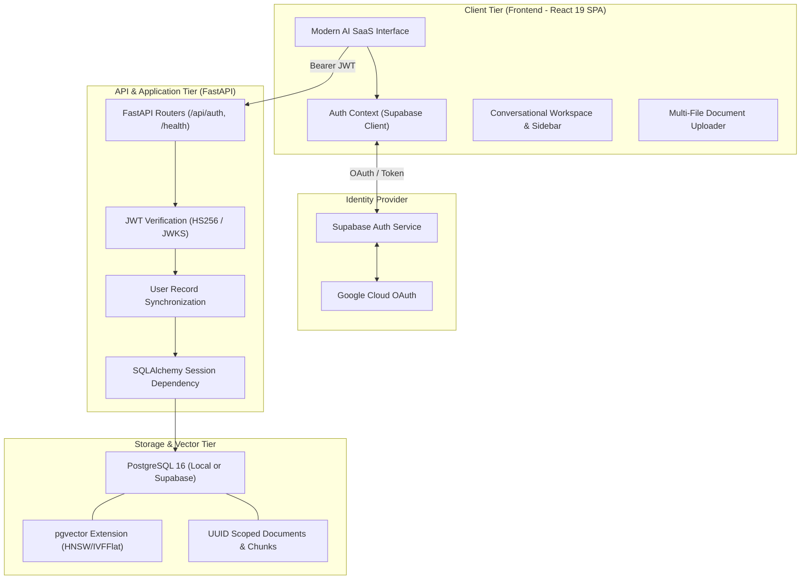

# KnowFlow System Architecture (KF-04)

This document details the architectural design, component responsibilities, communication protocols, and security boundaries for **KnowFlow**, a document-based Retrieval-Augmented Generation (RAG) knowledge assistant.

---

## 1. System Overview

KnowFlow is architected as a modular, decoupled full-stack platform designed to allow authenticated users to privately upload documents (PDF and TXT), index them into high-dimensional vector spaces, and query them using natural language with verifiable source citations and contextual conversational history.

---

## 2. Layer Responsibilities

### 2.1 Client Layer (Frontend)
- **Framework:** React 19, TypeScript, Vite.
- **Design Philosophy:** Minimalist dark navy/slate AI assistant (inspired by modern conversational intelligence interfaces like ChatGPT and Gemini).
- **Security:** Zero access to database credentials or third-party service role keys. Authenticated state managed securely with Supabase persistent sessions and Bearer token headers.
- **Routing:** Protected route guards redirecting unauthenticated traffic to `/login`.

### 2.2 Identity & Authentication Tier
- **Provider:** Supabase Auth with Google OAuth and Email/Password flows.
- **Tokens:** Stateless JSON Web Tokens (JWT) containing subject UUID (`sub`), email, and user metadata.

### 2.3 Application Layer (FastAPI Backend)
- **Framework:** Python 3.12, FastAPI, Pydantic v2.
- **Security Boundary:** Independent cryptographic verification of Supabase JWTs without trusting client-side claims.
- **Tenant Isolation:** Enforces user ownership (`user_id = token.sub`) on all document and chat queries.

### 2.4 Storage & Vector Layer (PostgreSQL & pgvector)
- **Engine:** PostgreSQL 16 with `pgvector` extension (v0.8.7).
- **Compatibility:** Operates interchangeably with local Docker PostgreSQL and hosted Supabase PostgreSQL.
- **Data Models:** All user-scoped tables (`documents`, `conversations`) reference `users.id` (UUID) with `ON DELETE CASCADE`.

---

## 3. Communication & Security Boundaries

1. **Zero Client Trust:** The frontend never decides resource ownership or passes plain user IDs for authorization.
2. **Cascading Erasure:** Deleting a document or user automatically purges associated chunks and conversation history.
3. **Prompt Injection Boundary:** Uploaded documents are treated as untrusted text, separated by explicit delimiters during RAG synthesis.
