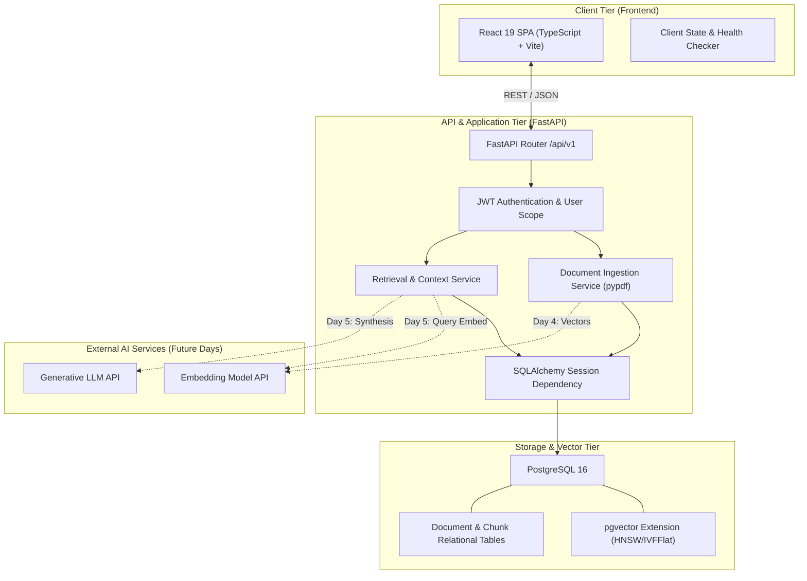

# KnowFlow System Architecture (KF-04)

This document details the architectural design, component responsibilities, communication protocols, and security boundaries for **KnowFlow**, a document-based Retrieval-Augmented Generation (RAG) knowledge assistant.

---

## 1. System Overview

KnowFlow is architected as a modular, decoupled full-stack platform designed to allow authenticated users to privately upload documents (PDF and TXT), index them into high-dimensional vector spaces, and query them using natural language with verifiable source citations and contextual conversational history.

---

## 2. Layer Responsibilities

### 2.1 Client Layer (Frontend)
- **Framework:** React 19, TypeScript, Vite.
- **Role:** Single Page Application (SPA) providing intuitive user interfaces for document upload, conversational querying, citation inspection, and account management.
- **Boundaries:** Zero access to database credentials or third-party AI provider API keys. All state queries and mutations pass through the FastAPI backend via structured REST endpoints.

### 2.2 Application Layer (FastAPI Backend)
- **Framework:** Python 3.12, FastAPI, Pydantic v2.
- **Role:** Central orchestrator managing business logic, document validation, layout-aware text extraction, chunking, and database operations.
- **Dependency Injection:** Database sessions are provisioned per request via `get_db()`, guaranteeing proper cleanup, rollback on exception, and connection pooling.
- **Configuration Management:** Environment-driven settings loaded via `pydantic-settings`, preventing secrets from being embedded into the source tree.

### 2.3 Storage & Vector Layer (PostgreSQL & pgvector)
- **Engine:** PostgreSQL 16 with the official `pgvector` extension (v0.8.7).
- **Role:** Unified persistence for relational data (users, documents, conversations, messages) and vector data (dense chunk embeddings).
- **Isolation:** Enforces relational integrity using foreign keys with `ON DELETE CASCADE`.

### 2.4 AI Integration Layer (Planned Days 4 & 5)
- **Embedding Provider:** Converts cleaned document text chunks and incoming user queries into dense numerical vectors.
- **LLM Provider:** Generates grounded answers based strictly on retrieved context passages with citation anchors.

---

## 3. Communication & Security Boundaries

### 3.1 Authentication & Authorization
- **Token Mechanism:** Stateless JSON Web Tokens (JWT) using HMAC-SHA256 or asymmetric signing.
- **Tenant Isolation:** Every document, document chunk, conversation, and message is linked to a specific `user_id`. Queries unconditionally enforce `WHERE user_id = :current_user_id` before similarity search or retrieval to prevent cross-user data leakage.

### 3.2 Content Sanitization & Untrusted Data Handling
- Uploaded files are treated strictly as **untrusted passive data**, never executed or interpreted as instructions.
- File headers, MIME types, and maximum sizes are validated before text extraction.
- Retrieved document text inserted into LLM prompt templates is enclosed within explicit structural context fences to mitigate indirect prompt injection.

---

## 4. Current Implementation Status (Day 1)

| Component | Status | Description |
| :--- | :--- | :--- |
| **Project Structure** | Implemented | Clean modular directories for backend, frontend, docs, and docker. |
| **PostgreSQL 16 & pgvector** | Implemented | Docker Compose container running pgvector 0.8.7 with persistent volume. |
| **FastAPI Backend** | Implemented | Modular app with `/health`, `/health/db`, and OpenAPI docs at `/docs`. |
| **SQLAlchemy & Alembic** | Implemented | DeclarativeBase, session manager, and initial schema migration executed. |
| **React Frontend** | Implemented | React 19 + TypeScript + Vite with live health dashboard and roadmap display. |
| **Vector Columns** | Deferred | Intentionally deferred to Day 4 to match final embedding model dimensions. |
