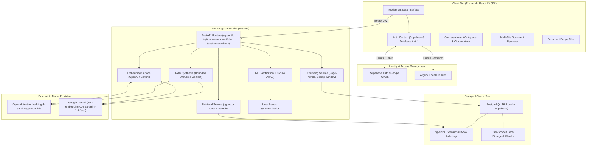

# KnowFlow System Architecture (KF-04)

This document details the architectural design, component responsibilities, communication protocols, and security boundaries for **KnowFlow**, a document-based Retrieval-Augmented Generation (RAG) knowledge assistant.

---

## 1. System Overview

KnowFlow is architected as a modular, decoupled full-stack platform designed to allow authenticated users to privately upload documents (PDF and TXT), index them into high-dimensional vector spaces, and query them using natural language with verifiable source citations and contextual conversational history.

---

## 2. Layer Responsibilities

### 2.1 Client Layer (Frontend)
- **Framework:** React 19, TypeScript, Vite.
- **Design Philosophy:** Minimalist dark navy/slate AI assistant inspired by modern conversational intelligence interfaces (ChatGPT and Gemini).
- **Security:** Zero access to database credentials or third-party service role keys. Authenticated state managed securely with Supabase sessions and Bearer token headers. Stale/expired sessions trigger clean redirection to `/login`.
- **Chat Workspace:** Collapsible conversation sidebar, markdown-rendered answers, expandable citation cards, document scope selector, and copy response actions.
- **Routing:** Protected route guards redirecting unauthenticated traffic to `/login`.

### 2.2 Identity & Authentication Tier
- **Dual Support:** Supabase Auth (Google OAuth & hosted Email/Password) and Argon2-hashed local database credentials verified directly by FastAPI.
- **Tokens:** Stateless JSON Web Tokens (JWT) containing subject UUID (`sub`), email, and metadata, verified via JWKS, `SUPABASE_JWT_SECRET`, or local `SECRET_KEY`.

### 2.3 Application Layer (FastAPI Backend)
- **Framework:** Python 3.12, FastAPI, SQLAlchemy 2.0, Pydantic v2.
- **Security Boundary:** Independent cryptographic verification of Bearer JWTs without trusting client-side claims.
- **Tenant Isolation:** Enforces user ownership (`user_id == token.sub`) on all document and chat queries.
- **Chunking Engine:** Splits extracted text into bounded chunks with configurable size and overlap while preserving 1-based page numbers from `pypdf`.
- **Vector Embeddings:** Connects to OpenAI (`text-embedding-3-small`) or Gemini (`text-embedding-004`) to generate dense float vectors.
- **RAG Synthesizer:** Bounded context construction treating document text as untrusted data to mitigate prompt injection, validating citations against retrieved passages.

### 2.4 Storage & Vector Layer (PostgreSQL & pgvector)
- **Engine:** PostgreSQL 16 with `pgvector` extension (v0.8.7).
- **Index:** High-performance HNSW index on `document_chunks.embedding` using cosine distance operator (`vector_cosine_ops`).
- **Data Integrity:** Cascading deletes on `documents` ensure that deleting a document purges all chunk records and prevents future retrieval from deleted files.

---

## 3. Communication & Security Boundaries

1. **Zero Client Trust:** The frontend never decides resource ownership or passes plain user IDs for authorization.
2. **Cascading Erasure:** Deleting a document or conversation automatically purges associated chunks, messages, and storage files.
3. **Prompt Injection Boundary:** Uploaded documents are treated as untrusted text, separated by explicit delimiters during RAG synthesis.
4. **Insufficient Evidence Fallback:** If retrieved evidence does not meet similarity thresholds, the system returns a clear fallback response without fabricating facts or citations.
