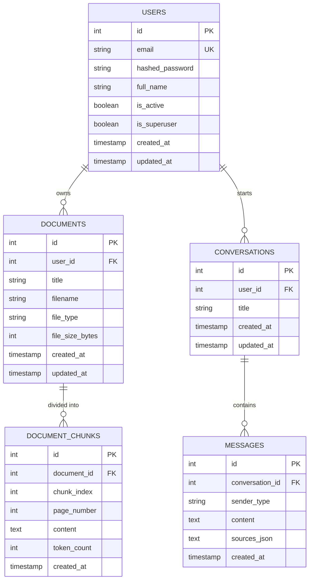

# KnowFlow Database Design (KF-04)

This document describes the schema architecture, relationships, constraints, and data integrity guarantees for the **KnowFlow** application.

---

## 1. Schema Diagram

---

## 2. Table Specifications

### 2.1 `users` Table
Stores authenticated user accounts.
- `id` (INTEGER, Primary Key, Auto-increment)
- `email` (VARCHAR(255), Unique, Indexed, Non-null): Login credential.
- `hashed_password` (VARCHAR(255), Non-null): Salted password hash (Argon2 / bcrypt).
- `full_name` (VARCHAR(255), Nullable): Display name.
- `is_active` (BOOLEAN, Default: true, Non-null): Account state flag.
- `is_superuser` (BOOLEAN, Default: false, Non-null): Administrative privileges.
- `created_at` (TIMESTAMP WITH TIME ZONE, Non-null): Creation timestamp.
- `updated_at` (TIMESTAMP WITH TIME ZONE, Non-null): Modification timestamp.

### 2.2 `documents` Table
Stores metadata for files uploaded by users.
- `id` (INTEGER, Primary Key, Auto-increment)
- `user_id` (INTEGER, Foreign Key → `users.id` ON DELETE CASCADE, Indexed, Non-null): Owner ID.
- `title` (VARCHAR(255), Non-null): Human-readable document title.
- `filename` (VARCHAR(255), Non-null): Original file name.
- `file_type` (VARCHAR(50), Non-null): MIME or file extension (`pdf`, `txt`).
- `file_size_bytes` (INTEGER, Non-null): File size in bytes.
- `created_at` (TIMESTAMP WITH TIME ZONE, Non-null): Upload timestamp.
- `updated_at` (TIMESTAMP WITH TIME ZONE, Non-null): Last update timestamp.

### 2.3 `document_chunks` Table
Stores partitioned segments of documents used for RAG context retrieval.
- `id` (INTEGER, Primary Key, Auto-increment)
- `document_id` (INTEGER, Foreign Key → `documents.id` ON DELETE CASCADE, Indexed, Non-null): Parent document.
- `chunk_index` (INTEGER, Non-null): Order of chunk within document.
- `page_number` (INTEGER, Nullable): Source page number in original document.
- `content` (TEXT, Non-null): Raw textual content of the chunk.
- `token_count` (INTEGER, Nullable): Approximate token length.
- `created_at` (TIMESTAMP WITH TIME ZONE, Non-null): Extraction timestamp.
- *(Planned for Day 4)*: `embedding vector(N)`: High-dimensional vector embedding.

> **Design Note on Vector Dimensions:**  
> The vector embedding column is intentionally omitted during Day 1. Establishing arbitrary vector dimensions before selecting the embedding model risks data corruption or forced migrations. Once the exact model (e.g. 768 or 1536 dimensions) is chosen in Day 4, an Alembic migration will add the vector column with an appropriate index (HNSW or IVFFlat).

### 2.4 `conversations` Table
Tracks user interaction sessions.
- `id` (INTEGER, Primary Key, Auto-increment)
- `user_id` (INTEGER, Foreign Key → `users.id` ON DELETE CASCADE, Indexed, Non-null): Owner ID.
- `title` (VARCHAR(255), Non-null): Conversation session title.
- `created_at` (TIMESTAMP WITH TIME ZONE, Non-null)
- `updated_at` (TIMESTAMP WITH TIME ZONE, Non-null)

### 2.5 `messages` Table
Stores chronological turns within conversations.
- `id` (INTEGER, Primary Key, Auto-increment)
- `conversation_id` (INTEGER, Foreign Key → `conversations.id` ON DELETE CASCADE, Indexed, Non-null)
- `sender_type` (VARCHAR(50), Non-null): `"user"` or `"assistant"`.
- `content` (TEXT, Non-null): Message text.
- `sources_json` (TEXT, Nullable): JSON serialization of cited chunks with page references.
- `created_at` (TIMESTAMP WITH TIME ZONE, Non-null)

---

## 3. Data Integrity & Authorization Guarantees

1. **Cascading Deletion:** Deleting a `document` immediately deletes all associated `document_chunks` through foreign key `ON DELETE CASCADE`. This guarantees deleted documents cannot leak passages into vector searches.
2. **Access Isolation:** Every retrieval query filters document chunks via document ownership verification (`JOIN documents ON documents.id = document_chunks.document_id WHERE documents.user_id = :user_id`), ensuring zero cross-tenant visibility.
