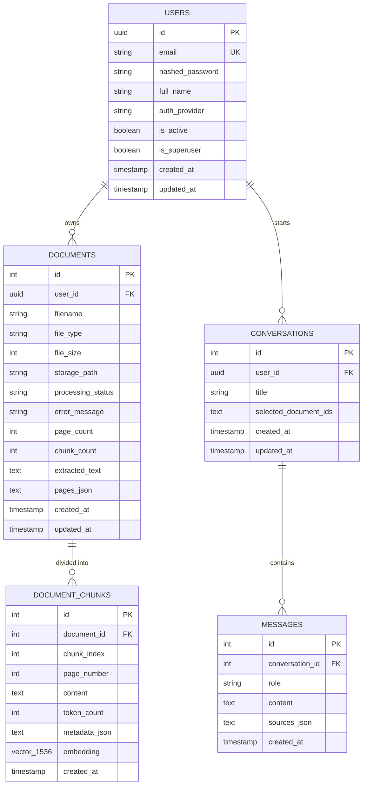

# KnowFlow Database Design (KF-04)

This document describes the schema architecture, relationships, constraints, and data integrity guarantees for the **KnowFlow** application.

---

## 1. Schema Diagram

---

## 2. Table Specifications

### 2.1 `users` Table
Stores authenticated user accounts synced with Supabase Auth or registered directly via local database authentication.
- `id` (UUID, Primary Key): Unique identifier matching Supabase `auth.users.id` or generated for local users.
- `email` (VARCHAR(255), Unique, Indexed, Non-null): Login credential.
- `hashed_password` (VARCHAR(255), Nullable): Argon2 password hash for local users.
- `full_name` (VARCHAR(255), Nullable): User display name.
- `auth_provider` (VARCHAR(50), Default: "email", Non-null): Authentication provider (`"google"`, `"email"`, `"local"`).
- `is_active` (BOOLEAN, Default: true, Non-null): Account state flag.
- `is_superuser` (BOOLEAN, Default: false, Non-null): Administrative privileges.
- `created_at`, `updated_at` (TIMESTAMP WITH TIME ZONE, Non-null).

### 2.2 `documents` Table
Stores metadata, disk storage paths, and raw extracted text for user-uploaded documents.
- `id` (INTEGER, Primary Key, Auto-increment).
- `user_id` (UUID, Foreign Key → `users.id` ON DELETE CASCADE, Indexed, Non-null).
- `filename` (VARCHAR(255), Non-null): Sanitized original file name.
- `file_type` (VARCHAR(50), Non-null): Extension / type (`"pdf"` or `"txt"`).
- `file_size` (INTEGER, Non-null): Size in bytes.
- `storage_path` (VARCHAR(500), Non-null): Non-public local storage disk path.
- `processing_status` (VARCHAR(50), Default: "uploaded", Non-null): Lifecycle state (`"uploaded"`, `"processing"`, `"completed"`, `"failed"`).
- `error_message` (TEXT, Nullable): Diagnostic error message if processing failed.
- `page_count` (INTEGER, Nullable): Total pages extracted for PDFs.
- `chunk_count` (INTEGER, Nullable, Default: 0): Total chunks generated.
- `extracted_text` (TEXT, Nullable): Aggregated text across all pages.
- `pages_json` (TEXT, Nullable): JSON array of `{ "page_number": int, "text": str }`.
- `created_at`, `updated_at` (TIMESTAMP WITH TIME ZONE, Non-null).

### 2.3 `document_chunks` Table
Stores semantic text chunks indexed with `pgvector` dense vector embeddings for RAG retrieval.
- `id` (INTEGER, Primary Key, Auto-increment, Indexed).
- `document_id` (INTEGER, Foreign Key → `documents.id` ON DELETE CASCADE, Indexed, Non-null).
- `chunk_index` (INTEGER, Non-null): Sequential order of chunk within document.
- `page_number` (INTEGER, Nullable): 1-based page number from original PDF or 1 for TXT.
- `content` (TEXT, Non-null): Textual passage content.
- `token_count` (INTEGER, Nullable): Estimated token length.
- `metadata_json` (TEXT, Nullable): Serialized JSON metadata (filename, page number, char count).
- `embedding` (VECTOR(1536), Nullable): Dense float vector embedding.
- `created_at` (TIMESTAMP WITH TIME ZONE, Non-null).

> **Index:** `idx_document_chunks_embedding` is an HNSW index on `embedding` using `vector_cosine_ops` for sub-millisecond approximate nearest neighbor searches.

### 2.4 `conversations` Table
Tracks user interaction sessions with optional document scope filters.
- `id` (INTEGER, Primary Key, Auto-increment, Indexed).
- `user_id` (UUID, Foreign Key → `users.id` ON DELETE CASCADE, Indexed, Non-null).
- `title` (VARCHAR(255), Default: "New Chat", Non-null): Conversation title.
- `selected_document_ids` (TEXT, Nullable): JSON-serialized list of scoped document IDs (`[1, 2]`) or null for all documents.
- `created_at`, `updated_at` (TIMESTAMP WITH TIME ZONE, Non-null).

### 2.5 `messages` Table
Stores chronological turns within conversations along with verified source citations.
- `id` (INTEGER, Primary Key, Auto-increment, Indexed).
- `conversation_id` (INTEGER, Foreign Key → `conversations.id` ON DELETE CASCADE, Indexed, Non-null).
- `role` (VARCHAR(50), Non-null): `"user"` or `"assistant"`.
- `content` (TEXT, Non-null): Message text body.
- `sources_json` (TEXT, Nullable): Serialized JSON array of cited chunks (`[{document_id, filename, page_number, chunk_index, snippet, similarity}]`).
- `created_at` (TIMESTAMP WITH TIME ZONE, Non-null).

---

## 3. Data Integrity & Authorization Guarantees

1. **Cascading Deletion:** Deleting a document immediately cascades to delete all corresponding `document_chunks` via foreign key `ON DELETE CASCADE`. This guarantees that deleted documents can never be retrieved or cited in future queries.
2. **Strict Tenant Isolation:** Every retrieval query filters document chunks via document ownership verification (`JOIN documents ON documents.id = document_chunks.document_id WHERE documents.user_id = :user_id AND documents.processing_status = 'completed'`).
3. **Foreign Key Integrity:** All session and document tables reference `users.id` with `ON DELETE CASCADE`, ensuring no orphaned records exist upon account deletion.
