# KnowFlow RAG Pipeline (KF-04)

This document describes the Retrieval-Augmented Generation (RAG) architecture for KnowFlow, detailing the future Ingestion Pipeline and Question-Answering Pipeline planned for Days 3, 4, and 5.

---

## 1. End-to-End Pipeline Overview

```mermaid
flowchart TD
    subgraph Ingestion_Flow["Document Ingestion Pipeline (Days 3 & 4)"]
        A1["Upload PDF / TXT"] --> A2["MIME & Size Validation"]
        A2 --> A3["Text Extraction (pypdf)"]
        A3 --> A4["Layout & Metadata Tagging (Page Numbers)"]
        A4 --> A5["Recursive Character Chunking (500-1000 tokens)"]
        A5 --> A6["Generate Embeddings (Vector API)"]
        A6 --> A7["Store in PostgreSQL (pgvector)"]
    end

    subgraph Retrieval_Flow["Question-Answering Pipeline (Days 5 & 6)"]
        B1["User Question"] --> B2["JWT Authentication & Tenant Scope"]
        B2 --> B3["Generate Query Vector"]
        B3 --> B4["Cosine Similarity Search (Top-K Chunks)"]
        B4 --> B5["Authorization Filter (User-owned Docs Only)"]
        B5 --> B6["Context Construction & Prompt Synthesis"]
        B6 --> B7["LLM Inference with Citation Anchors"]
        B7 --> B8["Citation Validation & Source Verification"]
        B8 --> B9["Stream Answer & Sources to User"]
    end
```



---

## 2. Ingestion Pipeline Details

### Step 1: Upload & Initial Validation
- Allowed file formats: PDF (`application/pdf`) and plain text (`text/plain`).
- File size capped at 15MB to prevent memory exhaustion and denial-of-service.
- Content header inspection prevents file extension spoofing.

### Step 2: Text Extraction & Structure Preservation
- PDFs are parsed using `pypdf` with page tracking to record physical page numbers.
- Unprintable characters, null bytes, and malformed encoding are sanitized.

### Step 3: Chunking Strategy
- Recursive text splitting with sliding window overlap (e.g. 500-token chunks with 50-token overlap).
- Preserves sentence boundaries and paragraph coherence.
- Each chunk preserves metadata: `document_id`, `chunk_index`, and `page_number`.

### Step 4: Embedding Generation & Storage
- Text chunks are encoded into dense float vectors via an embedding model.
- Vectors and chunk text are inserted into PostgreSQL `document_chunks` using `pgvector`.
- An index (HNSW or IVFFlat) accelerates nearest-neighbor searches.

---

## 3. Question-Answering Pipeline Details

### Step 1: Query Authentication & Authorization
- Requests require a valid Bearer JWT token.
- The active user's identity determines the search filter scope:
  $$\text{Target Documents} = \{ d \in \text{Documents} \mid d.\text{user\_id} = \text{current\_user}.\text{id} \}$$

### Step 2: Query Embedding & Semantic Retrieval
- The user query is converted into an embedding using the identical model and dimensionality.
- PostgreSQL performs vector similarity search (cosine distance `<=>`):
  ```sql
  SELECT chunk.id, chunk.content, chunk.page_number, doc.filename,
         1 - (chunk.embedding <=> :query_vector) AS similarity
  FROM document_chunks chunk
  JOIN documents doc ON doc.id = chunk.document_id
  WHERE doc.user_id = :current_user_id
  ORDER BY chunk.embedding <=> :query_vector
  LIMIT :top_k;
  ```

### Step 3: Context Construction & LLM Prompting
- The top-$k$ retrieved chunks are formatted with explicit delimiters:
  ```
  You are KnowFlow, a document research assistant. Answer the question using ONLY the provided context.
  If the context does not contain sufficient evidence, state clearly: "I cannot find this information in the uploaded documents."
  Always cite your sources using [Doc: <filename>, Page: <page>].

  --- CONTEXT PASSAGES ---
  [Passage 1] (Doc: report.pdf, Page: 4)
  ...passage content...
  --- END CONTEXT ---

  Question: {user_question}
  ```

### Step 4: Citation Validation & Delivery
- Generated responses are checked to confirm cited passages exist within the retrieved set.
- Answer and structured citations are delivered to the frontend client and recorded in `messages`.
